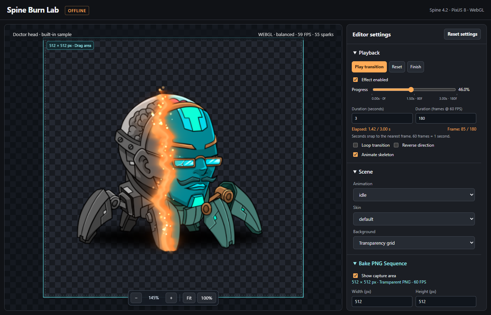

# Pixi Spine FX Lab

An [Agent Skill](https://agentskills.io/specification) that teaches an AI coding agent to build **configurable PixiJS visual-effect editors for Spine animations**. It ships a complete, tested, fully offline editor as the starting point, so the agent adapts a working product instead of writing a Spine viewer, camera, baker and exporter from scratch.



> The bundled reference effect is a **burn-to-grayscale transition with flame and sparks**. It is a reference implementation, not the only effect the skill can produce: built-in PixiJS filters, compatible `pixi-filters`, custom GLSL/WGSL, filter chains and extra effect layers are all in scope.

## What you get

**A working editor** (`assets/Spine_Burn_Lab.html`, one self-contained file, no network needed):

- Loads Spine **4.2.x** exports: JSON or binary `.skel`, atlas and textures, including **multipage atlases**, meshes, clipping, skins and sequence attachments.
- Large preview viewport with display-only camera (wheel zoom at the pointer, Fit, 100%) and an independently scrolling settings sidebar.
- Animation, skin and background selection, playback, timing in seconds and in frames at 60 FPS, quality presets (Low / Balanced / High).
- **Transparent PNG sequence baking**: identical-size, untrimmed RGBA frames at fixed 60 FPS sample times, seeded randomness, cancellation, byte-identical output regardless of camera zoom.
- **Developer exports**: separate WebGL and WebGPU ZIPs (WebGPU with WebGL fallback) containing the preset, your Spine assets, the shared effect module, readable shaders, a runnable Vite example and an English README.
- A built-in sample skeleton so the editor works the moment it opens.

**A workflow for the agent** (`SKILL.md` plus `references/`): how to review a requested effect before coding, which infrastructure must be preserved, where the burn-specific assumptions live, and an acceptance matrix with effect-specific checks.

**Scripts** (`scripts/`): bootstrap an editable copy, build the single-file HTML, verify protected assets and essential controls, and run a headless browser smoke test on both backends.

## Runtime pins

| Component | Version |
| --- | --- |
| PixiJS | 8.22.0 |
| `@esotericsoftware/spine-pixi-v8` | 4.2.120 |
| Accepted Spine exports | 4.2.x |

Libraries are vendored in the repository and embedded into the built HTML. Nothing is fetched at runtime.

## Try the editor

Open `assets/Spine_Burn_Lab.html` in a current Chromium-based browser. The built-in sample loads automatically; use the *Spine assets* panel to load your own export (select the skeleton, the atlas and **every** texture page, then press *Load preview*).

## Install as a skill

**Claude Code**

```bash
git clone https://github.com/maximsokal/pixi-spine-fx-lab ~/.claude/skills/pixi-spine-fx-lab
```

For a single project, clone into `.claude/skills/pixi-spine-fx-lab/` instead. The folder must contain `SKILL.md` directly, not nested a second time.

**Claude (web / desktop)**

Download the ZIP from the [latest release](https://github.com/maximsokal/pixi-spine-fx-lab/releases/latest) (its top-level entry is the `pixi-spine-fx-lab/` folder), or zip the repository yourself so the top-level entry is the `pixi-spine-fx-lab/` folder, then use *Customize > Skills > Add skill > Upload a skill* and enable it. Code execution and file creation must be enabled for the scripts and generated files.

**Other Agent Skills hosts**

The layout is the standard `SKILL.md` + `scripts/` + `references/` + `assets/`. `agents/openai.yaml` holds UI metadata for compatible OpenAI hosts and can be ignored elsewhere.

See [references/installation.md](references/installation.md) for details.

## Use it

Ask for an effect in plain language, for example:

> Use pixi-spine-fx-lab to create a cyan and gold aura behind my animated Spine character, with independent glow strength, radius and colors, a pulse timing control, and all the existing exports.

The skill makes the agent clarify unclear look and endpoint questions (at most three), propose a reviewed plan, wait for approval, and only then implement and validate the effect.

### Run the scripts directly

Requires Python 3.10+. The build uses only the standard library.

```bash
# 1. Copy the editable baseline (output must be a new or empty directory outside the skill)
python scripts/bootstrap_editor.py --output /path/to/my-fx-lab

# 2. Check pinned assets, assembly markers and the essential controls
python scripts/verify_project.py /path/to/my-fx-lab

# 3. Assemble the offline single-file editor
python scripts/build_editor.py /path/to/my-fx-lab --output /path/to/My_FX_Lab.html
python scripts/verify_project.py /path/to/my-fx-lab --html /path/to/My_FX_Lab.html

# 4. Browser regression on WebGL and WebGPU (needs Node.js, Playwright and Chromium)
node scripts/smoke_editor.cjs --html /path/to/My_FX_Lab.html --backend both --output /path/to/qa-results
```

If Playwright is not resolvable normally, set `PLAYWRIGHT_MODULE` to its module path and `BROWSER_EXECUTABLE` to a Chromium executable. Set `FX_SOFTWARE_GPU=1` to pass software-GPU flags to Chromium on machines without a usable GPU. Building the generated Vite examples needs Node.js 20.19+ or 22.12+.

The smoke test checks, per backend: the built-in sample loads completely (all atlas pages, all animations, skins), no network requests, a 6-frame bake with correct PNG dimensions and alpha, byte-identical frames at different camera zooms, and both developer ZIPs including every sample file. It checks infrastructure only; it does not judge the look of a new effect.

## Repository layout

```text
SKILL.md                    Skill entry point and rules for the agent
agents/openai.yaml          UI metadata for OpenAI-compatible hosts
references/                 Product contract, effect contract, workflow, validation matrix, adaptation map
scripts/                    bootstrap_editor.py, build_editor.py, verify_project.py, smoke_editor.cjs
assets/Spine_Burn_Lab.html  Prebuilt offline reference editor
assets/template/            Editable source of that editor
  src/                      ui.html, effect-core.js (shared effect), export-ui.js (exports)
  vendor/                   Pinned PixiJS and spine-pixi-v8 builds
  licenses/                 Third-party notices embedded in every build
  sample/                   Built-in sample skeleton, atlas and textures
  template.json             Runtime pins, sample manifest, protected file hashes
docs/screenshot.png         README image
```

## Replacing the built-in sample

The sample is declared in the `sample` block of `assets/template/template.json`:

```json
"sample": {
  "label": "Doctor head",
  "skeleton": "sample/Doctor_head.json",
  "atlas": "sample/Doctor_head.atlas",
  "images": ["sample/Doctor_head.png", "sample/Doctor_head_2.png"]
}
```

`build_editor.py` embeds exactly these files and fails if the atlas references a texture page that is not listed. After changing the sample, update its SHA-256 entries under `protectedFiles` (they are verified by `verify_project.py`), rebuild `assets/Spine_Burn_Lab.html`, update `baselineHtmlSha256`, and run the smoke test. The sample must be a Spine 4.2.x export.

## Scope and limitations

Not included in the shipped baseline: MP4/WebM export, importing Spine editor `.spine` projects, the Spine 4.3 runtime, and every `pixi-filters` implementation. The skill does not promise automatic translation of an arbitrary effect to every backend; when a design cannot fit WebGL, WebGPU or a device budget, the intended behavior is to state the limitation and propose a reviewed alternative.

Validation status: the burn baseline passes the bundled smoke test on WebGL and WebGPU in desktop Chromium. That is **not** a physical-device performance certificate, and the skill has not been validated on phones. Every new effect needs its own visual checks.

## License and third-party notices

- Original code, scripts and documentation: [MIT](LICENSE).
- **PixiJS** is MIT licensed, see [assets/template/licenses/pixi.txt](assets/template/licenses/pixi.txt).
- **Spine Runtimes** (`spine-pixi-v8`) are distributed under the [Spine Runtimes License](assets/template/licenses/spine.txt). Using them requires that **each user of the resulting product holds their own Spine Editor license**, and redistribution must keep the license and copyright notice. These terms apply to the editor, to the developer ZIPs and to anything you build with them.
- The sample artwork in `assets/template/sample/` is all rights reserved and is included for demonstration only. See [NOTICE.md](NOTICE.md).

This repository is not affiliated with Esoteric Software or the PixiJS project.

## Repository architecture checks

The repository includes pinned dependency-cruiser and Knip checks. See [docs/architecture-tooling.md](docs/architecture-tooling.md) for scope, commands, statik installation, known dynamic-reference limitations, baseline results, and the proposed CI rollout. These are repository-maintenance tools; they are not dependencies of the offline editor.
