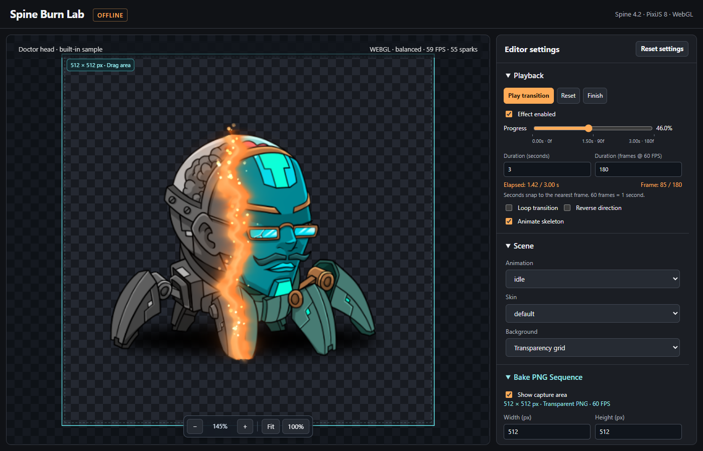

# Pixi Spine FX Lab — Documentation

**Pixi Spine FX Lab** is a reusable [Agent Skill](https://agentskills.io/specification) and collection of self-contained, offline PixiJS editors for making adjustable visual effects around Spine animation exports. This Wiki is the human-facing guide; the versioned technical contracts and source code remain in the [repository](https://github.com/maximsokal/pixi-spine-fx-lab).

## Start here

- [[Getting-Started]] — install the skill, run an editor, and create a working copy.
- [[Effect-Editors]] — fourteen available reference editors and specification-only examples.
- [[Working-with-Spine-Assets]] — JSON/SKEL, atlas textures, skins, and animations.
- [[PNG-Baking-and-Developer-Exports]] — deterministic frame sequences and integration packages.
- [[Agent-Workflow-and-Contracts]] — review, approval, Blueprints and contract selection.
- [[Architecture-and-Extension-Points]] — source layout and safe ways to extend an effect.
- [[Validation-and-Tests]] — focused reproducible validation.
- [[Runtime-Compatibility]] — precisely what is supported and what is proposed.
- [[Troubleshooting]] — common failures, environment settings and diagnostics.

## Current shipped baseline

| Capability | Current behavior |
| --- | --- |
| PixiJS | Pinned **8.22.0** |
| Spine runtime | Pinned **spine-pixi-v8 4.2.120**; accepts **Spine 4.2.x** exports |
| Operation | Self-contained editor HTML with bundled vendors and example assets; offline |
| Authoring | Interactive viewport, effect-specific artist controls, animation/skin selection |
| Output | Transparent PNG sequences, JSON metadata, separate WebGL and WebGPU-oriented developer ZIPs |
| Effect selection | Versioned Blueprint catalog with 14 implemented/reference entries and 2 spec-only entries |

**Important distinction:** GitHub issues describe both working features and planned work. The additional 41-effect issue catalog does **not** mean 41 finished editors. Optional PixiJS 5–7 and Spine 3.7–4.3 documents are research/specifications, not supported alternate runtime packages.

[README](https://github.com/maximsokal/pixi-spine-fx-lab/blob/main/README.md) · [FX source index](https://github.com/maximsokal/pixi-spine-fx-lab/blob/main/references/fx/index.md) · [Issue tracker](https://github.com/maximsokal/pixi-spine-fx-lab/issues) · [Licensing](https://github.com/maximsokal/pixi-spine-fx-lab/blob/main/NOTICE.md)

*Documentation reflects inspected repository main as of 2026-11-23. An editor's existence is not a physical-device certification; check targeted visual and backend evidence for your use case.*
